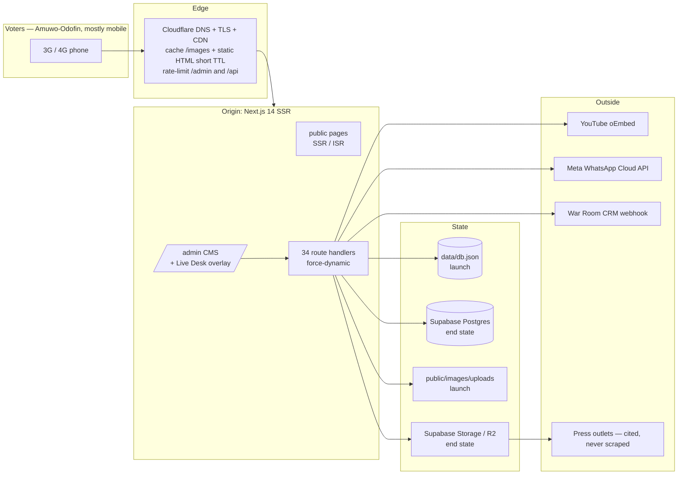

# OlaWestern.ng — Deployment Guidebook, Roadmap and Technical Breakdown

**Site:** official campaign site for Hon. Engr. Folorunsho Olaitan Segun ("Ola Western"), APC, Lagos State House of Assembly, Amuwo-Odofin Constituency I
**Codebase:** `ola-western-web` — Next.js 14.2.15 (App Router), TypeScript, Tailwind 3.4, 34 API route handlers, two interchangeable data backends
**Author's evidence base:** every "what the code does" statement below was read out of this repository on 2026-11-03; every hosting limit is cited at the bottom under [Sources](#18-sources).
**Vendor:** developed by i2sltd.tech

---

## 0. How to use this book

| If you are… | Read |
|---|---|
| Deciding where this goes | §1, §4, §5 |
| The engineer doing the deploy | §6, then the one path you chose (§7–§11) |
| Campaign HQ approving go-live | §16 roadmap (T-6 weeks → T-0), §16.4 voter test, §14 security |
| Answering "why is it slow in Festac?" | §13 |
| Recovering from an incident | §15.4 playbooks |

Everything below assumes the site is currently running exactly as it does on the vendor laptop: `npm run build && next start`, data in `data/db.json`, photos in `public/`, the Live Desk editing pages in place.

---

## 1. The answer, in one page

**Can PaaS hold this end to end?** Yes — but not every PaaS, and not with the current data layer. The project has three stateful habits that decide the host:

1. **The data store writes to disk.** `src/lib/store.ts` keeps the whole campaign database in an in-process cache and flushes it to `data/db.json` with `fs.writeFileSync` + `renameSync`, retrying on `EPERM/EBUSY/EACCES`. That needs a **writable, persistent, single-writer filesystem**.
2. **The photo library writes to disk.** `POST /api/admin/media/upload` (`runtime = 'nodejs'`, 10 MB cap) does `fs.mkdirSync` + `fs.writeFileSync` into `public/images/uploads/`, then reads real pixel dimensions back from the bytes with a hand-rolled header probe (no `sharp`). That needs **disk plus a public URL for what you wrote**.
3. **The Live Desk edits content that is already cached somewhere.** Of the 14 prerendered routes, **eight carry a timed revalidation** (`export const revalidate`): `/`, `/about`, `/impact`, `/gallery`, `/contact` at 3600 s, `/news` and `/truth-room` at 900 s, `/help-desk` at 300 s. The other six — `/privacy`, `/join`, `/blueprint`, `/robots.txt`, `/sitemap.xml`, `/icon.svg` — are `initialRevalidateSeconds: false`, i.e. immutable until rebuild. So on a long-running server, `revalidatePath()` + `router.refresh()` regenerate the page in memory and the desk's save appears immediately (verified in a browser this session); on a CDN host the same pages are ISR entries with a **staleness budget of up to an hour**, and whether `revalidatePath()` purges the edge copy early depends on the host's Next.js runtime.

**Can we deploy everything serverless to Netlify?** Yes — **all features, serverless, on Netlify** — but only after the porting work in §6. Not before. If you deploy this folder to Netlify as-is:

- `data/` is in `.gitignore`, so the deployed build contains **no campaign data at all** and reseeds from `src/lib/content.ts`; every deploy resets the Truth Room ledger, the track record, the media library and the settings, and **deletes every collected volunteer lead and Ask-Ola inquiry**.
- Photo uploads land on ephemeral, read-mostly lambda disk: they may serve until the next cold start, then 404 for voters.
- A 10 MB photo exceeds the function payload ceiling (Vercel 4.5 MB; Netlify documents ~6 MB sync / 4.5 MB configurable) → `413 FUNCTION_PAYLOAD_TOO_LARGE`, and the desk just sees "upload failed" on a phone.
- Serverless can scale to many concurrent clones of the same function, each with its own `cache` — the last writer wins and silently overwrites the other's rows.
- Conversely, the parts that are already serverless-proof: stateless HMAC session cookie (no server-side session store), all 34 route handlers are `force-dynamic` (no build-time data assumptions), no middleware, no native modules, only one runtime dependency plus `@supabase/supabase-js`, `AbortSignal.timeout` on the YouTube lookup.

The supported serverless shape is: **Next.js on Netlify/Vercel (ISR + route handlers) + Supabase Postgres for every row + Supabase Storage or Cloudflare R2 for every photo, reached by a presigned direct upload** — with explicit invalidation wired to the desk's save. That is §6 (work order) and §7 (step-by-step).

**What can go live this week with everything working and no code changes?** A persistent server: one container PaaS instance with a mounted volume (Render / Koyeb / Fly.io) or a small VPS, running the same `next start` you verified today, behind Cloudflare for TLS, DDoS frontage and asset caching. Same filesystem semantics the app was built against, so the file store, uploads, undo and Live Desk revalidation all behave exactly as tested. That is §9 (container) and §10 (VPS).

**My recommendation for this campaign:** ship **Path C (persistent container + Cloudflare) for launch**, and run the **Path A serverless port (§6) as the scale-over work** before the heaviest period (party primaries → general election), because CDN-cached static pages survive a rumour spike far better than one origin. Both paths are documented end to end; they share §12 (data), §13 (performance), §14 (security), §15 (operations).

**Do not deploy as a pure static export (Path D) as the live site.** `NEXT_OUTPUT=export` produces the frozen `out/` bundle used for the Qoder Sites pitch preview; it skips `headers()` and the API routes, the capture forms intentionally show the "preview build" notice, and the Live Desk has nothing to write to. Good for a pitch deck; not a campaign's CMS.

---

## 2. What you are actually deploying (verified inventory)

Read from the repository and from a clean production build on 2026-11-03.

**Framework and dependencies.** `next@14.2.15`, `react@18.3.1`, `react-dom@18.3.1`, `@supabase/supabase-js@^2.45.0`. Dev: TypeScript 5.5, Tailwind 3.4, PostCSS, autoprefixer. **No `sharp`, no ORM, no native binding, no middleware file.** Build target Node 20 (`netlify.toml` pins it; CI pins it).

**Runtime shape.** SSR build by default. `next.config.mjs` switches to `output: 'export'` + `trailingSlash` + `images.unoptimized` **only** when `NEXT_OUTPUT=export` (the `scripts/sites-export.mjs` pitch-preview path). Security headers (`HSTS max-age=63072000 includeSubDomains preload`, `X-Frame-Options SAMEORIGIN`, `nosniff`, `Referrer-Policy strict-origin-when-cross-origin`, `Permissions-Policy`, `poweredByHeader: false`) are attached through `headers()` — which **does not exist in export mode**, so any host serving the frozen bundle must re-declare them.

**Image policy.** `formats: ['image/avif','image/webp']`, `remotePatterns` allow `**.supabase.co` and `res.cloudinary.com` — i.e. the config is already prepared for off-origin photography, which is exactly what §6 uses.

**Routes and their runtime classification (from the last build).**

| Class | Count | What it means |
|---|---|---|
| `○` prerendered with timed ISR | 8 pages (`revalidate` 300–3600 s) | Fresh within that budget; `revalidatePath()` may shorten it |
| `○` prerendered, `initialRevalidateSeconds: false` | 6 (`/privacy`, `/join`, `/blueprint`, `/robots.txt`, `/sitemap.xml`, `/icon.svg`) | Immutable until rebuild |
| `ƒ` dynamic | 34 `/api/**` handlers | Always run per request; all declare `export const dynamic = 'force-dynamic'` |
| `ƒ` with `runtime = 'nodejs'` | 1 (`/api/admin/media/upload`) | The only route that explicitly refuses the edge |
| Client components | gallery carousel, help desk, truth room, join, contact, admin dashboard, Live Desk overlay | Hydration only; no server requirement |

Shared first-load JS is 87.2 kB; every page lands between ~87 kB and ~102 kB first load — good numbers for a 3G audience, and worth protecting in any hosting decision.

**Endpoint surface** (full table in [Appendix A](#appendix-a-endpoint-inventory)). Public write paths: `/api/volunteer`, `/api/inquiry`, `/api/issues` (POST), `/api/fact-check` (GET), `/api/truth-room/sync` (inbound webhook, `WAR_ROOM_SECRET_KEY`), plus `/api/media`, `/api/videos`, `/api/issues` reads. Every `/api/admin/**` handler checks `isAdminRequest()` and returns 401 otherwise (verified: anonymous `GET /api/admin/health` → 401).

**Auth.** `src/lib/admin.ts`: stateless `ow_admin_session` cookie, payload `{exp}` at 12 h, HMAC-SHA256 signature with `timingSafeEqual`, `httpOnly`, `sameSite: 'lax'`, `secure` when `NODE_ENV === 'production'`. Key = `ADMIN_SECRET` → else `ADMIN_PASSWORD` → else the literal `ola-western-cms-dev-secret`. Login is **fail-closed**: in production, `adminPassword()` returns `''` when `ADMIN_PASSWORD` is unset or shorter than 8 chars, and the handler rejects when `!expected` — so an unconfigured production host cannot be logged into (it simply has no working CMS). No server session table, no sticky routing requirement, works on any host, survives scale-out.

**Data layer.** `src/lib/store.ts` exposes one interface over two backends, chosen by credentials: Supabase Postgres when `NEXT_PUBLIC_SUPABASE_URL` + anon key exist (writes need `SUPABASE_SERVICE_ROLE_KEY`), else the file store. Migrations are in `supabase/migrations/0001_init.sql` and `0002_cms_content_tables.sql` and must be applied **in that order**. Seed rows are re-merged when `SEED_VERSION` changes, campaign-collected rows survive, and deliberate deletions of bundled rows are kept as tombstones in `db.removed` — a design detail that matters at deploy time: **deleting `data/db.json` resurrects rows the desk withdrew.**

**Content volume today.** `data/db.json` 52 KB; `public/` 13 MB (83 press photos, 3 generated artworks, 0 desk uploads so far); `.next/` 100 MB; `node_modules/` 287 MB. Build time is minutes, not hours; nothing here needs a big machine.

**Integrity and gates (what "correct" means post-deploy).** `/api/admin/health` returns the campaign's own defensibility score — currently **40, 6 findings, 4 block lines** (three track-record entries and one Truth Room ruling the reference library does not actually attest). `scripts/check-cms-gates.mjs` runs 12 checks against any base URL (`BASE=https://…`) and proves the publish gate is holding. Both are part of every deploy verification below.

**What is NOT in the codebase, and must not be assumed:** no `output: 'standalone'`, no Dockerfile, no `next.config` `experimental` flags, no queue/worker, no cron route, no rate limiter, no object-storage SDK, no image CDN integration, no `.git` directory (the folder is not yet a repository), and the existing GitHub Action is a Vercel deploy that (a) uses the archived `amondnet/vercel-action@v25` and (b) passes only the two public Supabase env vars — the service-role key, `ADMIN_PASSWORD`, `ADMIN_SECRET`, `WAR_ROOM_*` and `WHATSAPP_*` are referenced nowhere, so that workflow cannot currently produce a working production site. §15 fixes it.

---

## 3. The five constraints that decide your host

| # | Constraint | Where it lives | Serverless PaaS | Container PaaS + volume | VPS | Static export |
|---|---|---|---|---|---|---|
| 1 | Writable persistent DB | `store.ts` file backend | ✗ (needs Postgres) | ✓ | ✓ | ✗ |
| 2 | Writable uploads + public URL | `media/upload` | ✗ (needs object storage) | ✓ | ✓ | ✗ |
| 3 | Desk edits must reach voters | `revalidatePath` + prerendered pages | ~ (host-dependent) | ✓ | ✓ | ✗ (rebuild only) |
| 4 | 10 MB photo in one POST | `MAX_BYTES` | ✗ (4.5–6 MB payload caps) | ✓ | ✓ | n/a |
| 5 | Node-only APIs (`fs`, `crypto`) | `store.ts`, `uploads.ts`, `admin.ts` | ✓ Node runtime route handlers are fine | ✓ | ✓ | ✗ |

Row 3 is the one teams get wrong: the desk sees its own edit because `router.refresh()` re-renders from the origin, while the CDN keeps serving the old HTML to voters. On a campaign that means "I published the rebuttal an hour ago and nobody has seen it" — and the worst time to discover it is during a rumour. **Whatever host you pick, the post-deploy test in §16.4 (log out of the desk, fetch the page as a voter, confirm the new sentence is there) is mandatory.**

---

## 4. Architecture options, compared

### Path A — Serverless Next.js (Netlify or Vercel) + managed Postgres + object storage
The modern, low-ops shape, and the only one that is genuinely "100% serverless with all features". Requires the §6 port. Pages become ISR (or on-demand revalidated), route handlers become functions, photos live in Supabase Storage/R2 behind a CDN, the desk's save triggers an invalidation. Scales flat under a spike; costs scale with bandwidth, not with your nerves.

### Path B — One container with a mounted volume (Render, Koyeb, Fly.io)
`next start` exactly as tested today, one instance, one writable disk. Almost no code change (add `output: 'standalone'`). You keep the file store, uploads, undo, in-memory cache. Ops burden: you watch disk, backups and restarts. Scale is vertical: a bigger box, not more boxes.

### Path C — VPS (London or Lagos-region) + Docker/systemd + Caddy + Cloudflare in front
Total control, the best price/performance for a Nigerian audience if you place origin and CDN sensibly, and the only shape that lets you keep NDPA-held personal data on a disk you can encrypt and physically reason about. Ops burden highest: patching, TLS renewal, fail2ban, backups, and one human who answers at 11pm.

### Path D — Static export on a CDN/bucket host (Netlify drop, Cloudflare Pages, S3+CloudFront, Qoder Sites)
Cheapest and most bulletproof for reading. No server means no forms, no CMS writes, no Live Desk, no photo library, no webhook sync — the capture forms deliberately announce the preview state. Right for a pitch, a mirror, or an "election-day read-only snapshot"; wrong as the campaign's working site.

### Decision matrix

| | A: serverless | B: container+volume | C: VPS | D: static |
|---|---|---|---|---|
| Feature parity **as the code stands today** | no | **yes** | **yes** | no |
| Feature parity after §6 port | **yes** | yes | yes | never |
| Survives a rumour spike (10–50× traffic) | **yes, by construction** | needs a bigger box | needs Cloudflare caching | **yes** |
| TTFB for Amuwo-Odofin on 3G | good if HTML is edge-cached; origin in US/EU otherwise | depends on region you pick | best with a Lagos/London origin + CDN | **best** |
| Ops skill required to keep it alive | low | low–medium | **medium–high** | trivial |
| Cost at 100k visits/month, 13 MB→60 MB of photos | low–medium | low | **lowest** | lowest |
| Photo uploads >6 MB | needs presigned path | native | native | n/a |
| Personal data (leads) residency | Supabase region (choose EU/US consciously) | your volume, your choice | your disk, your choice | none collected |
| Rollback | redeploy previous build | redeploy image | redeploy container | re-upload files |
| Single point of failure | the host's platform | one container, one disk | one box | none |
| Best used for | the live campaign site, once ported | **launch this week** | steady-state control, lowest cost | pitch previews |

---

## 5. Recommended target architecture

For launch (Path C/B) and for the scale-over end state (Path A), the pieces are the same; only the write path moves.



Rules the architecture has to keep honouring, because they are the product:

- **Nothing publishes on a timer or on an inbound webhook alone.** Human-in-the-loop is architectural here: the CMS needs an authenticated session, the War Room sync only reaches drafts, and resident Help Desk reports stay invisible until the desk publishes them. Any host change (cron jobs, edge functions, queue consumers) must not create a route that writes to a public page without a human pressing Save.
- **No unsourced claim survives the gate.** `POST /api/admin/record` and `/api/admin/fact-checks` refuse a row without its evidence link; `PATCH` may replace it, never empty it; `DELETE` is the only takedown. Keep that server-side in every topology — a client-side-only gate is no gate.
- **No AI-generated imagery of the candidate, ever.** Real press photography with the outlet's credit only. This is a hosting-agnostic rule but it shapes storage: photos must keep their credit and caption metadata when you move them to object storage.
- **Personal data is minimised and provable.** `volunteers.consent_at` is stored and exported so an NDPA erasure/objection request can be answered with a date. Whoever hosts the DB therefore hosts a legal obligation; §14.4 covers it.

---

## 6. Porting work order — what must change before Path A is true

Eight items, each small, each with a test. Do them on a branch, one commit each, and keep Path C/B deployable throughout (the file store stays a supported backend; you are adding, not replacing).

**6.1 Move every row to Postgres.** Set the four Supabase variables, apply `0001` then `0002`, and give the CMS a service-role key. *Test:* save one row from every CMS tab and from the Live Desk, then `node scripts/check-cms-gates.mjs` against the deployed URL. The store already switches automatically; the failure mode is silently running on the file backend because one variable is missing — verify with `storageState()` surfaced in the `/admin` header.

**6.2 Move photos off the filesystem.** Replace `fs.writeFileSync` in `media/upload` with an object-storage put (Supabase Storage bucket or R2), keep the byte-level header probe so orientation/dimensions still drive slot fitting, and store the returned public URL in the `media` row. `remotePatterns` already permits `**.supabase.co`. *Test:* upload a 4 MB phone photo from a browser on a throttled connection; confirm it renders in the frame within a minute and survives a redeploy.

**6.3 Break the payload ceiling with a presigned or proxied upload.** Function bodies cap at 4.5 MB (Vercel) / ~6 MB (Netlify); the desk's contract says 10 MB. Either issue a presigned PUT and have the browser send the file straight to storage (best: no function in the data path at all), or set the route's limits and accept a documented cap. Do not let the desk discover `413` as a toast labelled "upload failed". *Test:* push a 9 MB file and confirm either success or an actionable, specific message.

**6.4 Give the desk a publish path with a stated staleness budget.** The eight content pages already revalidate on a timer (3600 s on `/`, `/impact`, `/about`, `/gallery`, `/contact`; 900 s on `/news` and `/truth-room`; 300 s on `/help-desk`), so a save is *eventually* correct on any host — the question is how long a voter waits to see a rebuttal. Choose deliberately:
 - tighten `revalidate` on the pages the desk edits under pressure (`/truth-room` to 60–120 s is the honest default for a rumour response), or
 - wire host-native on-demand invalidation into the save handlers so `revalidatePath()` maps to a real CDN purge and the edit is live in seconds, or
 - serve those pages dynamically (`dynamic = 'force-dynamic'`) and accept the TTFB cost — for a campaign, 60 s of staleness beats 100 ms of speed, but a Truth Room that lags an hour during a rumour is a political problem, not a technical one.
 Whatever you pick, write the number down in the go-live checklist so the desk knows what "published" means on each surface.
 *Test:* this is the §16.4 voter test, and it must pass on the production URL, not localhost — time it, and record the observed delay.

**6.5 Make the outbound integrations asynchronous.** `POST /api/volunteer` stores the lead, then `await Promise.allSettled([pushLeadToWarRoom(record), sendWhatsAppWelcome(...)])` before it answers — and neither call sets a timeout (the YouTube lookup does: `AbortSignal.timeout(6000)`). On a long-running server the cost is a slow response. On serverless it is worse in a specific way: a cold or stalling CRM can consume the whole function budget **after the lead is already saved**, so the volunteer sees a failed submission while the row exists, and tries again — duplicates in your registry. Wrap both in a timeout, cap the wait, and move real delivery to a host-native function or queue with retry, recording the attempt on the lead so the desk can see what was and wasn't pushed.
 *Test:* point `WAR_ROOM_WEBHOOK_URL` at a sink that sleeps 20 s; the `/join` POST must still return success inside the function budget, the lead must be present exactly once, and the push attempt must be visible to the desk.

**6.6 Add `output: 'standalone'` for the container paths and keep it harmless elsewhere.** `next.config.mjs` has no `output` today, so a Docker image must copy `node_modules` (287 MB dev, still large in prod). Standalone emits a self-contained `.next/standalone`. *Test:* `npm run build && node .next/standalone/server.js` serves the site locally.

**6.7 Re-declare headers wherever `next.config` is not honoured.** Export mode and some CDN configurations skip `headers()`. Mirror the same six headers in `_headers`, the host's header UI, or Cloudflare rules. HSTS `preload` is a commitment: it applies to every subdomain and is hard to undo — decide deliberately before you submit to the preload list, and make sure both `olawestern.ng` and `www` have valid certificates and an HTTP→HTTPS redirect at the apex. *Test:* `curl -sI https://… | grep -iE 'strict|frame|nosniff|referrer'`.

**6.8 Fix the pipeline.** The existing workflow cannot deploy a working site (§2, last paragraph). Replace the archived action with the host's official CLI/action, add every production secret, and gate deploy on the two checks you already own: `npm run build` and `node scripts/check-cms-gates.mjs`. *Test:* open a PR; the deploy job must refuse to run when the gate script fails.

**Not required for serverless** (so you can stop worrying about them): the signed cookie session is stateless; there is no middleware to port; no native modules to rebuild; the Live Desk is pure client overlay over the existing routes; the Truth Room and Help Desk pages are hydration, not WebSockets; and there is no long-lived connection anywhere in the app, so no sticky sessions.

---

## 7. Path A, step by step — Netlify with full serverless features

1. **Make the repository real.** `git init`, commit `src/ public/ supabase/ scripts/ netlify.toml next.config.mjs package.json package-lock.json .env.example README.md DEPLOY-netlify.md`; keep `/data`, `/out`, `/.next`, `.env.local`, `*.pem` ignored (the existing `.gitignore` is already correct). Push to your Git host.
2. **Provision the state.** Create a Supabase project (pick the region consciously — see §14.4 on residency). Run `0001_init.sql`, then `0002_cms_content_tables.sql`, in the SQL editor. Create a public `media` Storage bucket and note the project URL, anon key and service-role key. Nothing here goes in Git.
3. **Do the §6 port** (6.1, 6.2, 6.3, 6.4, 6.5 at minimum) and verify against a local `npm run build && next start` first.
4. **Create the site.** Netlify → *Add new site → Import an existing project* → the repo. `netlify.toml` supplies `command = "npm run build"` and `NODE_VERSION = "20"`; Netlify's built-in Next.js runtime takes the build output and wires cache control and revalidation for you.
5. **Set environment variables** (§14.1 table) in Site configuration → Environment variables, **not** in the TOML. `NODE_ENV` is the platform's business; set `NEXT_PUBLIC_SITE_URL=https://olawestern.ng` before the build so sitemap and OG tags are right.
6. **Deploy, then verify the runtime shape** before touching DNS: `GET /api/admin/login` → `{authenticated:false}` for a cookie-less probe (a voter must see no Live Desk DOM at all); a login → `POST /api/admin/record` without an evidence link → **400 with the exact `EVIDENCE_RULE` sentence**; `GET /api/admin/health` authenticated → a score.
7. **Run the gate suite against the live URL:** `BASE=https://<preview>.netlify.app node scripts/check-cms-gates.mjs` → expect `12/12 checks passed.`
8. **Do the voter test (§16.4)** on the preview URL: edit a headline in the Live Desk, log out or open a private window, confirm the new sentence is served from the edge. **If this fails, do not point the domain at it** — go back to 6.4.
9. **Add the domain.** Domain management → `olawestern.ng` + `www`. Netlify issues certificates; with Cloudflare DNS, either proxy through Cloudflare (§10.2) or set DNS-only and let Netlify terminate TLS. Keep the apex flattening behaviour your registrar supports in mind.
10. **Lock the desk.** Because `/api/admin/**` is public internet surface, add host-side protections: Cloudflare rate-limit `/admin` and `/api/admin/*`, an IP allowlist for HQ if it is stable, and "Block visitors" on the preview deploys so a draft deployment cannot be indexed.
11. **Delete the safety net you no longer need.** `netlify.toml` carries a commented Option B (static export). Leave it commented; if it ever goes live, the site stops being a CMS.

## 8. Path A′, step by step — Vercel

Identical shape, different knobs: import the repo; Vercel detects Next 14 and builds with its own Next runtime; set the same env vars (never `NEXT_PUBLIC_*` for the service-role key); functions are Node by default so your `runtime = 'nodejs'` upload route is compatible; **the 4.5 MB body cap is hard**, so 6.3 is mandatory, not optional; ISR works with `revalidate`, and `revalidatePath()` maps to Vercel's own invalidation path — still verify with the voter test. Replace the broken workflow with `vercel --prod` behind the build-and-gates job (§15.2). Add `SANDBOX`-free analytics sparingly; for a political site, decide consciously whether a third-party analytics cookie matches the promises made on `/privacy`.

## 9. Path B, step by step — one container with a volume (launch-fastest, zero porting)

1. Add `output: 'standalone'` to `next.config.mjs` (6.6) — the only code change.
2. `Dockerfile` (build once, run lean):
   ```dockerfile
   FROM node:20-alpine AS deps
   WORKDIR /app
   COPY package.json package-lock.json ./
   RUN npm ci

   FROM node:20-alpine AS build
   WORKDIR /app
   COPY --from=deps /app/node_modules ./node_modules
   COPY . .
   ARG NEXT_PUBLIC_SITE_URL NEXT_PUBLIC_SUPABASE_URL NEXT_PUBLIC_SUPABASE_ANON_KEY
   ENV NEXT_PUBLIC_SITE_URL=$NEXT_PUBLIC_SITE_URL \
       NEXT_PUBLIC_SUPABASE_URL=$NEXT_PUBLIC_SUPABASE_URL \
       NEXT_PUBLIC_SUPABASE_ANON_KEY=$NEXT_PUBLIC_SUPABASE_ANON_KEY
   RUN npm run build

   FROM node:20-alpine AS run
   WORKDIR /app
   ENV NODE_ENV=production PORT=3000 DATA_DIR=/data
   RUN addgroup -S app && adduser -S app -G app
   COPY --from=build --chown=app:app /app/.next/standalone ./
   COPY --from=build --chown=app:app /app/.next/static ./.next/static
   COPY --from=build --chown=app:app /app/public ./public
   COPY --from=build --chown=app:app /app/supabase ./supabase
   RUN mkdir -p /data && chown app:app /data
   USER app
   EXPOSE 3000
   CMD ["node", "server.js"]
   ```
   Two details that matter: `DATA_DIR=/data` points the file store at the mount (the code honours it), and the **initialise `/data` with your existing `data/db.json`** — if you don't, the container reseeds from `content.ts` and the desk's withdrawn rows come back.
3. Run it with a named volume and a health check:
   ```bash
   docker run -d --name ola-web -p 3000:3000 \
     -v ola-data:/data --env-file /etc/ola.env \
     --health-cmd 'wget -qO- http://127.0.0.1:3000/robots.txt >/dev/null || exit 1' \
     --health-interval 30s ola-web:latest
   ```
4. Render/Koyeb/Fly equivalents: one service, one instance, a disk mounted at `/data`, `NODE_ENV=production`, secrets injected as env, health check on `/robots.txt`. **Scale = 1.** Two clones with the file store means two caches and a lost-write race — that is a data-corruption configuration, not a performance one.
5. Verify: same three checks as step 6 in §7, plus the gate script, plus the voter test (which passes trivially here, because there is no CDN holding old HTML).

## 10. Path C, step by step — VPS self-host (lowest cost, most control)

**10.1 Machine and OS.** 2 vCPU / 2 GB / 40 GB SSD is ample for this build (13 MB of assets, 87 kB shared JS). Put the origin where your latency budget says to: a Nigeria-region host (or a Lagos-colocated box, if you have one) gives you the shortest RTT to Amuwo-Odofin; a London/Frankfurt box is ~90–150 ms RTT but has better peering stability. **Measure, don't guess:** run the §13.4 test matrix against both before you commit. Harden minimally: non-root user, `ufw allow 22,80,443`, `fail2ban` on sshd, unattended-upgrades, key-only SSH.

**10.2 TLS and CDN in front with Caddy + Cloudflare.** Caddy gives you automatic certificates and the header block that `next.config` cannot supply once you sit behind a proxy:
```caddyfile
olawestern.ng, www.olawestern.ng {
    encode zstd gzip
    redir https://olawestern.ng{uri} 308
    header Strict-Transport-Security "max-age=63072000; includeSubDomains; preload"
    header X-Frame-Options "SAMEORIGIN"
    header X-Content-Type-Options "nosniff"
    header Referrer-Policy "strict-origin-when-cross-origin"
    header Permissions-Policy "camera=(), microphone=(), geolocation=(self)"
    handle_path /images/* { root * /srv/ola/public/images; file_server; header Cache-Control "public, max-age=31536000, immutable" }
    reverse_proxy 127.0.0.1:3000 { header_up X-Forwarded-Proto https }
}
```
Cloudflare in front of Caddy (proxy DNS) buys you DDoS frontage, image caching close to Nigerian eyeball networks, a rate-limit rule on `/admin` and `/api/admin/*`, and a "I'm under attack" switch. Cache HTML **only** with a short edge TTL (30–60 s) or not at all; cache `/images/*` and `/_next/static/*` aggressively (the latter is content-hashed and immutable). If Cloudflare caches HTML, the voter test must be run **after** a purge, or the desk will believe its edit is live when it isn't.

**10.3 The app service.** Same image as §9 (or `npm ci && npm run build` on the box with systemd running `next start`). Environment from `/etc/ola.env` (`chmod 600`, root-owned). Bind 127.0.0.1 only.

**10.4 Backups, from day one.**
```bash
# /etc/cron.d/ola-backup — 02:00 daily, keep 30 days, off-box copy
0 2 * * * root /usr/local/bin/ola-backup
```
`ola-backup` = `tar` `/data` + `/srv/ola/public/images/uploads`, timestamped, `age`-encrypted, pushed to a second location (object storage + one copy the vendor does not control). **Restore it once, on a scratch box, before launch** — an untested backup is not a backup. §12.3 has the restore runbook.

## 11. Path D — static export (know exactly what it is)

`NEXT_OUTPUT=export npm run build` (or `npm run export:sites`) emits `out/`. API handlers and `headers()` disappear; images go unoptimised; the capture forms show the preview notice because there is no server to record them; the Live Desk has no authenticated session to open and the frames cannot be re-pointed. Use it for: the Qoder Sites pitch preview, a read-only election-day snapshot, a "the site is under attack, serve the frozen version" fallback. If you ever use it seriously, wire forms to a host-native service (Netlify Forms), keep `/privacy` honest about where that data lands, and treat it as **not** the campaign CMS.

---

## 12. Data, storage and migration runbook

**12.1 Which backend am I on?** `store.ts` chooses by credentials. `/admin` surfaces `storageState()`; `node scripts/check-cms-gates.mjs` prints the score it read. After any deploy, confirm the backend named on the dashboard is the one you intended — the classic failure is a missing service-role key: reads work, writes fail, and the desk only discovers it at 11pm.

**12.2 Seeding, tombstones and the `SEED_VERSION` contract.** The file store merges bundled seed rows whenever `SEED_VERSION` changes and keeps everything the campaign collected; rows the desk deleted by hand stay deleted because their ids are recorded in `db.removed`. Consequences: never delete `data/db.json` to "reset" a server — you resurrect withdrawn content; never hand-edit `db.json` on a live server while the CMS is writing (the process cache is authoritative and will flush over your edit); and when you move a live campaign from file store to Postgres, migrate the **content** rows deliberately, with the tombstone list in hand.

**12.3 File store → Postgres (the one migration you actually have to script).** Export `db.json`, apply `0001`+`0002`, load each collection into its table with the same ids and timestamps (so `data-ow` field targets and ledger ids keep working — the Live Desk addresses rows by id, e.g. `record.a12.verification_source_url`, `fact.fc-ballot.official_document_url`), then set the Supabase variables and restart. Verify: `check-cms-gates.mjs` 12/12, one save per CMS tab, the voter test on `/impact` and `/truth-room`, and confirm the leads CSV export still carries `consent_at`.
Restore: point the app at a clean project, load a backup, run the gate script, then flip the domain — never restore in place while the desk is editing.

**12.4 Media.** Launch: `public/images/uploads/` (desk uploads), `/images/press` (83 harvested photos, repository-owned, credit-bearing), `/images/generated` (3 branded panels — never candidate likenesses; there is no AI imagery of a real person here, and there must not be). End state: object storage with the same public URL shape, the credit and caption metadata kept on the `media` row, and `remotePatterns` already permitting the storage host. Whatever the host, keep the byte-level dimension probe: it is what stops a 495×619 portrait being forced into a 16:9 rally frame, and it is why the desk sees a live crop-percentage warning instead of discovering it on a billboard.

**12.5 What "the database" is legally.** Leads, inquiries and Help Desk reports are personal data about identified Nigerians, with consent timestamps. Whatever host you pick: encrypted at rest, backups encrypted, access limited to the admin session and the service role, reporter contacts stripped server-side before any public response, and a documented erasure path (`DELETE /api/admin/volunteers/[id]`, `/api/admin/inquiries/[id]`). Residency: a US or EU origin holding campaign voter data is a decision HQ should make knowingly, not an accident of whichever region the PaaS defaulted to.

---

## 13. Performance engineering for a mobile-first Nigerian audience

**13.1 What the build already gives you.** 87.2 kB shared first-load JS, 87–102 kB per page, no animation library (CSS/`requestAnimationFrame` and inline SVG), the YouTube shelf loads nothing from Google until a tap, press photography referenced with its credit. That is why this site works on a Lagos 3G connection; the deployment decision should not spend it.

**13.2 Where hosting changes the experience.** For a first visit, TTFB + HTML + images dominate; for a repeat visit (a voter who came from a WhatsApp forward), the CDN and cache headers dominate. Serverless with immutable edge HTML is the fastest; a single origin in a distant region with no HTML cache is the slowest. Cold start on a function is ~100–500 ms for this bundle size — invisible behind a cached page, painful on a cold `/truth-room` during a spike.

**13.3 Targets (write them into the go/no-go).**
- TTFB p75 from Lagos on mobile data: **< 600 ms cached, < 1.2 s uncached.**
- LCP on the gallery/impact hero images: **< 2.5 s** on a mid-tier Android over 4G.
- Total page weight under first-interaction: **< 500 kB** including the hero photograph, with AVIF/WebP where the host optimises.
- `/admin` on a throttled connection: a Live Desk save round-trips in **< 2 s** and passes the voter test within the stated staleness budget (60 s if you choose `revalidate = 60`).

**13.4 The measurement matrix (run it from a Nigerian mobile connection, not from your laptop).** For each page × {Wi-Fi, 4G, 3G-throttled} × {first visit, repeat visit}: LCP, TTFB, total bytes, and a screenshot. Test from a Lagos SIM or a mobile hotspot, not a VPN. Repeat at 8pm and at 2am; congested last-mile peering is a real variable that a US-based synthetic monitor will never show you. Then simulate a spike: `npx artillery` or `k6` with 300 concurrent voters against `/`, `/truth-room` and `/impact` plus 20 concurrent form POSTs against `/api/volunteer`, and watch for 5xx, for the file-store retry path in `save()` appearing in logs (it means contention), and for leads arriving with a `consent_at`.

---

## 14. Security and compliance hardening

**14.1 Environment variable reference.** Values never go in Git, in logs, in a screenshot, or in this document.

| Variable | Required | Purpose | Missing ⇒ what happens |
|---|---|---|---|
| `ADMIN_PASSWORD` | **yes** (≥8 chars) | CMS password | Production login is fail-closed: **nobody** can open the CMS |
| `ADMIN_SECRET` | **yes** | HMAC key for the session cookie | Falls back to the password (rotation kills sessions) then to a known literal |
| `NEXT_PUBLIC_SITE_URL` | **yes** | sitemap, robots, OG absolute URLs | Wrong canonical links, previews indexing |
| `NEXT_PUBLIC_SUPABASE_URL` / `_ANON_KEY` | end state | read path via Postgres | Runs on the file store |
| `SUPABASE_SERVICE_ROLE_KEY` | end state | CMS writes | Reads work, **every write fails** |
| `DATA_DIR` | Path B/C | where `db.json` lives | `<cwd>/data` — inside the image, wiped on redeploy |
| `WAR_ROOM_WEBHOOK_URL` / `WAR_ROOM_SECRET_KEY` | when the War Room is real | outbound lead push / inbound Truth Room sync | Lead push no-ops; sync endpoint unusable |
| `WHATSAPP_CLOUD_API_TOKEN` / `WHATSAPP_PHONE_NUMBER_ID` | when Meta approves the template | volunteer welcome message | Welcome silently skipped |
| `NEXT_PUBLIC_WHATSAPP_NUMBER` | optional | click-to-WhatsApp affordances | Button falls back to default behaviour |
| `NEXT_OUTPUT=export` | **never in production** | the pitch-preview static bundle | Freezes the site as a non-CMS |

**14.2 Rotate before you go live (this is not optional).** `ADMIN_PASSWORD` in the current local `.env.local` is the documented development fallback value, `ADMIN_SECRET` is unset, and `WAR_ROOM_SECRET_KEY` is a dev placeholder. Generate three long random values (`openssl rand -hex 32`), set them only in the host's secret store, and confirm an old password no longer authenticates. If this repository ever gains a git history, remember that `.env.local` and `/data` must stay ignored — the current `.gitignore` already does the right thing.

**14.3 Surface hardening.** All 34 route handlers are internet-visible; the admin ones are 401-gated (verified). Beyond that: rate-limit `/api/admin/login` (a password endpoint on the open internet) and `/api/admin/media/upload` (a disk-filling endpoint); keep the `secure` cookie flag honest by terminating TLS everywhere and redirecting HTTP at the edge; set the `SameSite=Lax` cookie to stay exactly as it is (it protects the desk from cross-site POSTs while allowing normal navigation); do not put the CMS on a subdomain that shares cookies with anything untrusted; keep `/blueprint` and any pitch artifacts out of the production build or behind auth; make preview deployments no-index. And the honest one: **the Live Desk's editing layer is already invisible to voters** (no overlay DOM without an authenticated session probe, `data-ow-missing` worklist chips `display:none` for the public) — do not weaken that while adding a WAF, because the site's credibility depends on visitors not seeing the scaffolding.

**14.4 NDPA and election-law hygiene.** `/privacy` needs legal review before launch. Consent is required and timestamped, exports are audit-dated, and disclosure appears on every capture form — keep that true when forms move to a host-native service (Path D), because "the data now goes to Netlify Forms" is a new processor relationship that has to be disclosed. Retention: decide a campaign policy for leads (and what happens to them after the election — deletion is a defensible answer and is much easier if the DB is one `DELETE` script rather than a scattered `db.json`).

---

## 15. Pipelines, operations and incident playbooks

**15.1 Environments.** `dev` (laptop, file store) → `preview` (per-PR, throwaway data, no-index, Supabase preview branch if you're on Path A) → `production` (one write path). Keep `/data` and the uploads directory **out of source control in every environment**; the file store is state, not configuration.

**15.2 The pipeline that should replace `deploy.yml`.** Build → gate → deploy → verify, on every push to `main`; preview builds on PRs; nothing publishes without the gates.
```yaml
# .github/workflows/deploy.yml (shape — provider CLI per your chosen path)
on: { push: { branches: [main] } }
jobs:
  ship:
    runs-on: ubuntu-latest
    environment: production          # ⇒ required reviewer + secrets scoped here
    steps:
      - uses: actions/checkout@v4
      - uses: actions/setup-node@v4
        with: { node-version: 20, cache: npm }
      - run: npm ci
      - run: npx tsc --noEmit
      - run: npm run build
        env: { NEXT_PUBLIC_SITE_URL: "https://olawestern.ng" }
      - run: npx next start -p 3000 &            # gate against the real artifact
      - run: sleep 6 && BASE=http://127.0.0.1:3000 node scripts/check-cms-gates.mjs
      - run: <host deploy, with secrets from the environment>
      - run: BASE=https://olawestern.ng node scripts/check-cms-gates.mjs   # post-deploy
      - run: curl -sI https://olawestern.ng | grep -i strict-transport-security
```
The two changes that matter: **gate on the checks you already wrote**, and **pass every production secret**, which the archived `amondnet/vercel-action@v25` version never did.

**15.3 Monitoring.** Synthetic checks on `/robots.txt` (cheap, no data) every 60 s from at least two regions **including a West African vantage**; alert on 5xx and on TTFB p95 > 2 s; alert on the integrity score dropping below the agreed launch threshold; ship logs (JSON, stdout) to a drain with 30-day retention, and put the `save()` retry messages on a dashboard — they are the file store's contention warning. Also monitor the disk: a campaign's photos grow faster than its database.

**15.4 Playbooks.**
- *Rumour spikes (the expected incident).* The desk writes a Truth Room ruling in `/admin` or directly on `/truth-room` with the Live Desk, attaches the document the ruling cites, and the publish gate refuses anything unsourced. Confirm the ruling passes the voter test before announcing the link in WhatsApp groups. If the origin is dying, purge the ruling onto the CDN, then, if necessary, cut over to a Path D snapshot with the rebuttal page baked in.
- *Defacement / leaked credentials.* Rotating `ADMIN_PASSWORD` and `ADMIN_SECRET` invalidates every desk session instantly (stateless cookie) — that is the strength of this design and the reason `ADMIN_SECRET` must be a real secret. Take the CMS path down at the edge, restore content from the last backup, diff the deploy against the pipeline commit.
- *Bad deploy.* Roll back to the previous artifact; **but restore data only if you also roll the artifact back**, or the tombstones and `SEED_VERSION` contract will fight the old code.
- *Disk full / uploads failing.* Clear `/data/*.tmp` strays, expand the volume, check the `EPERM/EBUSY` retry path isn't masking an antivirus or a second writer.
- *Two writers (Path B/C misconfiguration).* If someone scaled to 2 instances, leads are being lost silently. One writer, always, until you are on Postgres.

**15.5 Capacity.** 52 KB of database and 13 MB of assets are nothing; the growth axes are (a) photos — the press harvest is 83 files, and desk uploads will multiply that, (b) leads — a 30k-lead registry is still small, and (c) concurrency on the capture endpoints during a rally or a broadcast. Budget a 10× headroom on bandwidth, and remember that a single-origin Path B/C box needs a bigger machine while Path A just… doesn't notice.

---

## 16. Launch roadmap

**T-6 weeks — decisions.** Pick the path (recommended: **C or B now, A before the surge**). Rotate all credentials. Provision Postgres and object storage. Fix the pipeline (§15.2). Close the content gap the rail names: **four published lines still have no attesting report** — the indigent healthcare relief fund, the Penalty King youth tournament sponsorship and the community vigilante/estate security support on `/impact`, plus the "lawmakers are removed from the people" ruling on `/truth-room`. Get a document or a published report that *states* each claim, or withdraw it. Do not attach a link that merely mentions the candidate; the flagbearer report went on the ballot ruling because it names the party, the office and the constituency.
**Exit criteria:** `check-cms-gates.mjs` 12/12 against the deployed URL; integrity score above the agreed threshold; no block findings.

**T-5 weeks — data and integrations.** Migrate `db.json` → Postgres with tombstones (§12.3). Move uploads to object storage (6.2/6.3). Wire the async lead push with a timeout (6.5). Apply both Supabase migrations in order and prove a write from every CMS tab.

**T-4 weeks — the desk rehearses.** Train the campaign desk on the Live Desk: ⌘E to reveal, tap to edit, ⌘K to publish a clip or cite an article, ⌘Z to undo, the integrity rail before anything is shared. Rehearse one full rumour response end to end on a preview environment and time it. Confirm HQ's approval path for the War Room webhook stays human-in-the-loop.

**T-3 weeks — performance and networks.** Run the §13.4 matrix from a Lagos mobile connection at two times of day. Fix whatever it shows (usually hero image weight and HTML cache policy). Confirm both `olawestern.ng` and `www` resolve, redirect and carry valid certificates; decide the HSTS preload question deliberately.

**T-2 weeks — hardening and paperwork.** Rate limits and IP allowlists on `/admin`; backup restore rehearsed on a scratch box; `/privacy` legal review (NDPA 2023); confirm no AI-generated imagery anywhere and every photo credit names its outlet; confirm the footer carries "developed by @i2sltd.tech" pointing at `https://linktr.ee/i2sltd.tech`.

**T-1 week — freeze and dress rehearsal.** Deploy freeze except security fixes. Full smoke: every page, every form, the Truth Room sync, the leads CSV export with consent timestamps, the Live Desk voter test, mobile on the cheapest network you can find on the street.

**T-0 — go live.** Deploy during daylight, keep the desk on standby, monitor the dashboards, and re-run the gate script against the production URL immediately after DNS flips.

**Election day and after.** Pre-decide the read-only fallback (Path D snapshot) and who can trigger it; keep `consent_at` intact for every lead; schedule the post-election data-retention decision (delete, archive, or hand over) — do not let it drift.

**16.4 The voter test (run it on the production URL, every deploy).**
1. Live Desk on, change one distinctive sentence, Save, watch the page update.
2. Open a private/incognito window with no cookies. Fetch that page. Confirm the **new** sentence is served, and that no `data-ow` ring, dock, ⌘K or "add the report that proves this" chip is present in the HTML.
3. `curl -s https://olawestern.ng/impact | grep -c 'data-ow'` must be `0` for a voter.
4. Confirm `GET /api/admin/login` with no cookie answers `{authenticated:false}` and `GET /api/admin/health` answers 401.

If step 2 fails, staleness (not correctness) is your problem: shorten `revalidate`, or wire on-demand invalidation (6.4). If step 3 fails, the session gate is broken — treat it as a security incident, not a cosmetic one.

---

## 17. Cost and lock-in

Costs move; treat these as shapes, not quotes, and confirm current pricing on each vendor's own page before you budget.

| Shape | Fixed monthly | Scales with | Typical surprise bill | Lock-in risk |
|---|---|---|---|---|
| A — Netlify/Vercel + Supabase + storage | free/entry tier → small | bandwidth, function invocations, egress from storage | media egress during a viral week; function duration from un-timed outbound calls | low: Postgres is portable, photos are URLs, the app is stock Next.js |
| B — one container + volume | small, flat | instance size only | disk full from uploads | low |
| C — VPS + Caddy + Cloudflare | **lowest**, flat | box size; Cloudflare paid tiers for WAF rules | your time (the real cost) | lowest: any Linux box runs it |
| D — static on a CDN | near zero | bandwidth | forms gone; nobody notices until a lead is lost | none |

For a single-constituency campaign whose traffic is spiky, local and mobile, the honest ranking on **total cost of ownership including the vendor's evenings** is C ≈ B for launch, A for the surge, D only as a fallback. Avoid hosting that looks cheap but silently deletes your data (a serverless file store, or a free tier with no volume) — that is the one expensive mistake available here.

---

## Appendix A — endpoint inventory

| Endpoint(s) | Methods | Auth | Writes? | Serverless status |
|---|---|---|---|---|
| `/api/volunteer` | POST | public | yes (lead + consent timestamp), then CRM + WhatsApp push awaited inline | ✓ once on Postgres; push must be async (6.5) |
| `/api/inquiry` | POST | public | yes (Ask-Ola inquiry) | ✓ same |
| `/api/issues` | GET, POST | public | yes (resident Help Desk report; invisible until published) | ✓ |
| `/api/fact-check` | GET | public | no | ✓ |
| `/api/media`, `/api/videos` | GET | public | no | ✓ |
| `/api/truth-room/sync` | POST | `WAR_ROOM_SECRET_KEY` | drafts only — never publishes unattended | ✓ |
| `/api/admin/login` | GET (probe), POST, DELETE | password | sets/ clears `ow_admin_session` | ✓ stateless, no sticky sessions |
| `/api/admin/health` | GET | session | no (integrity score) | ✓ |
| `/api/admin/record`, `/fact-checks` (+`[id]`) | GET, POST / PATCH, DELETE | session | yes — **publish gate: evidence link required** | ✓ |
| `/api/admin/media` (+`[id]`) | GET, POST / PATCH, DELETE | session | yes (+ `purgeUpload` on disk) | needs 6.2 |
| `/api/admin/media/upload` | POST | session | writes file (10 MB, `runtime='nodejs'`) | needs 6.2 + 6.3 |
| `/api/admin/videos` (+`[id]`), `/videos/lookup` | GET, POST / PATCH, DELETE / GET | session | yes / YouTube oEmbed read (6 s timeout) | ✓ |
| `/api/admin/settings`, `/profile`, `/socials`, `/references`, `/press` (+`[id]`) | GET, POST, PATCH, PUT, DELETE | session | yes; references carry every press link | ✓ |
| `/api/admin/leads` (+`[id]`), `/leads/export`, `/inquiries/[id]`, `/issues/[id]`, `/volunteers/[id]` | GET, PATCH, DELETE, CSV export | session | yes; reporter contacts stripped server-side before any public response | ✓ |

## Appendix B — files that touch disk (the whole list, so you can grep it in review)

`src/lib/store.ts` (`node:fs`, `node:path`, `node:crypto` — the campaign DB), `src/lib/uploads.ts` + `src/app/api/admin/media/upload/route.ts` (`node:fs` — desk photographs), `src/lib/admin.ts` (`node:crypto` — HMAC only, no I/O), `scripts/*.mjs` (build-time tooling, never on the request path). Nothing else in `src/` imports `fs`.

## Appendix C — open questions for HQ (deployment cannot answer these)

Which region may hold voter personal data. Who is authorised to publish, and after whose approval. Whether HSTS preload is worth the commitment. Who is on call at 11pm on a Saturday in the last fortnight of the campaign. Whether the four unsourced lines get a document, a retraction, or a rewrite. Whether the campaign's own YouTube handle and office photograph (`hq-office`), family portrait (`family-portrait`), `23-road-inspection` and `community-security` frames get real photographs — those four frames currently show the branded panel because no press photograph on the internet documents them, and that is the honest answer until the campaign supplies one.

---

## 18. Sources

Hosting limits, runtime behaviour and the comparison claims above were checked against:

- [Vercel Functions Limits — 4.5 MB request/response payload](https://vercel.com/docs/functions/limitations)
- [Vercel knowledge base — bypassing the 4.5 MB body size limit](https://vercel.com/kb/guide/how-to-bypass-vercel-body-size-limit-serverless-functions)
- [Netlify — configuration for functions (payload size limits)](https://docs.netlify.com/build/functions/configuration/)
- [Netlify — async workload limitations (6 MB function payload ceiling)](https://docs.netlify.com/build/async-workloads/limitations/)
- [Netlify answers — maximum file size upload limit in a Netlify function](https://answers.netlify.com/t/what-is-the-maximum-file-size-upload-limit-in-a-netlify-form-submission/108419)
- [Netlify — Introducing the new Next.js Runtime (v5: cache control, on-demand revalidation)](https://www.netlify.com/blog/introducing-the-new-next-js-runtime/)
- [Netlify answers — on-demand revalidation for Next.js](https://answers.netlify.com/t/on-demand-revalidation-for-next-js/138681)
- [opennextjs-netlify issue #1288 — support for on-demand revalidation](https://github.com/opennextjs/opennextjs-netlify/issues/1288)
- [Next.js — how to implement Incremental Static Regeneration](https://nextjs.org/docs/app/guides/incremental-static-regeneration)
- [Cloudflare vs Vercel vs Netlify: edge performance in 2026](https://dev.to/dataformathub/cloudflare-vs-vercel-vs-netlify-the-truth-about-edge-performance-2026-50h0)
- [Vercel vs Netlify vs Cloudflare Pages in 2026](https://coderfile.io/blog/vercel-vs-netlify-vs-cloudflare-2026)
- [Web hosting comparison 2026 — Vercel, Netlify, Cloudflare, Render, DigitalOcean](https://www.luckymedia.dev/insights/hosting)
- [Vercel vs Netlify vs Cloudflare Pages — 2026 comparison](https://vareweb.com/blogs/vercel-vs-netlify-vs-cloudflare-pages-2026-comparison)
- [Vercel vs Cloudflare Pages vs Netlify — 2026 hosting comparison](https://pristren.com/blog/vercel-vs-cloudflare-pages-vs-netlify/)
- [Cloudflare vs. Vercel vs. Netlify, with and without public cloud](https://www.justaftermidnight247.com/insights/cloudflare-vs-vercel-vs-netlify-with-w-out-public-cloud/)

In-repo companions: [DEPLOY-netlify.md](C:/Users/C0sm0s/Desktop/OlaWestern/ola-western-web/DEPLOY-netlify.md) (short version), [README.md](C:/Users/C0sm0s/Desktop/OlaWestern/ola-western-web/README.md) (Live Desk, the publish gate, compliance guardrails, go-live checklist), [public/images/README.md](C:/Users/C0sm0s/Desktop/OlaWestern/ola-western-web/public/images/README.md) (the 20 photo frames).
